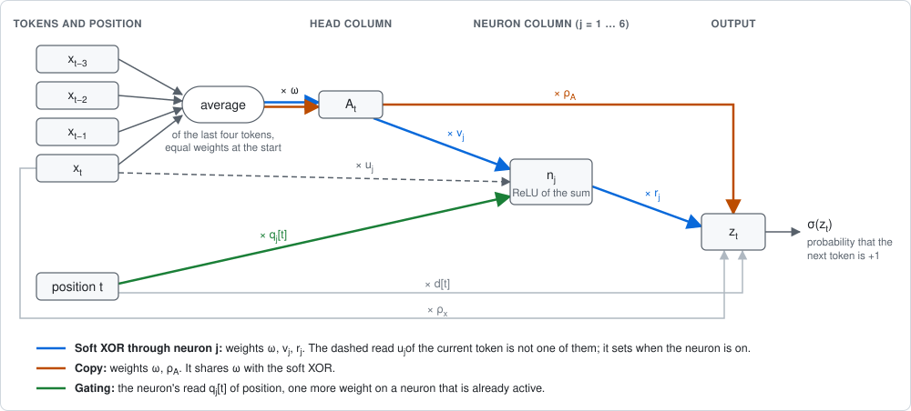

# A race between circuits

*Which circuit does a network learn first, and when? Notes from a discussion between Asvin G. and Claude (Fable 5.2), November 2026. Every number below is printed by a script in `race/` or computed from numbers one prints, and the printed outputs are kept in `race/outputs/`.*

## The puzzle

Train a small transformer on a simple sequence task and its loss curve is often a staircase. Nothing happens for a long time. Then a circuit appears and the loss drops, and after another wait a second circuit refines the first.

Here is the case this note starts from. The data, which we call RRXOR, are twelve tokens R R X R R X …, where R is a fair coin and X is the XOR of the two tokens before it. A one-layer transformer, trained by gradient descent from small weights, does three things that ask for an explanation.

- **It waits, and the wait varies.** The loss stays at 1 bit per token, the loss of guessing, until a time between 244 and 1,408 depending on the random seed.
- **It learns a rule that is half wrong.** The first circuit predicts the XOR of the last two tokens at every position, including the positions where the next token is a coin flip.
- **It corrects the rule on a different clock.** Restricting the prediction to XOR positions follows 114 to 220 time units later, however long the first wait was.

**The aim.** The puzzle is one instance of a larger programme. Take a task and a network trained on it by gradient descent. Write down a few circuits that could solve the task, in units larger than neurons where that helps. Price each circuit by the weights a network needs to implement it. Race the circuits against each other, and read off what the network learns and when. This note builds the model behind that programme and tests each part of it where it could fail. The first part, the law for one circuit, is solid. The last part, a race set beside a real transformer, has been carried through once and holds only in part.

**The picture in brief.**

- **One circuit.** A circuit is a set of weights that multiply along a path, and it does nothing until all of them have grown. Under plain gradient descent the wait is h_k(x₀)/g, for k weights of initial size x₀ and a gain g defined below. From small weights this predicts the plateau of the toy transformer within 3%. It gives the exponent 4 for six matrices in an ordinary transformer. It predicts a plateau from the literature within 14%, once a term we had missed is added.
- **Several circuits.** Circuits affect each other through the weights they share and through the error they leave. A weak circuit that grows a shared weight brings a strong one forward by a factor of 2 to 20, and a race of seven units says when.
- **A race beside a transformer.** Six hand-written units for a harder task, raced in time, pass through a soft XOR, then a cheap trick, then a circuit that detects the phase and rolls the trick back. A four-layer transformer passes through the same partial circuits in the same order. Its end state matches too, though the loss nearly forces that. Its timing matches only in part, and in mid-training 11 to 20% of its output comes from something that is not on our list.
- **The optimiser.** Adam changes the price. With exact gradients its wait hardly depends on k. In the layer-normed transformer its wait does not depend on the learning rate over a fourfold range, and we cannot yet say what sets it.
- **Not done.** The prices of hand-written units are our choice. In every test the loss fixes the circuit the network ends on, so only the schedule was at risk: no race has had a contested winner. No task has been raced before its answer was known.

**Where this sits.** Alternating Gradient Flows (Kunin, Marchetti et al., 2025) describes training as dormant neurons accumulating evidence until one activates. We take that alternation and extend it from single neurons to circuits whose parts depend on each other. On the optimiser, Kunstner et al. (2023) report that full-batch Adam behaves like sign descent and that sign descent degrades at small batch sizes, and Kou et al. (2024) show that sign SGD with large batches learns sparse parities at the statistical-query limit. We take both from a literature search and have not worked through them. What this note adds is the count: which weights are still small, and what each one costs under each optimiser.

**Conventions.** Losses are in bits per token. Under plain gradient descent, time is the number of steps times the learning rate; under Adam we count steps. A plateau ends, and a first drop happens, when the loss first falls under 0.95, unless another threshold is given. The initial size of a weight is x₀ in the model, the scale ε of the initial Gaussians in the toy transformer, and a multiple s of a standard deviation of 0.1 in the ordinary one-layer transformer. A bracket [ condition ] is 1 where the condition holds and 0 elsewhere.

## The model

The model is built in three steps, and each adds one thing to the step before.

**Step 1: a pool of units with one weight each.** Each unit u has a function φ_u of the input, its *output shape*, and one weight w_u.

    prediction    z = Σ_u w_u · φ_u(input)
    gain          g_u = −E[ δ · φ_u ],        δ = derivative of the loss with respect to z, at the current prediction
    learning      dw_u/dt = g_u

The last line is gradient descent. The gain is the correlation of a unit's shape with the current error: for the log loss of predicting an outcome y ∈ {0, 1} with probability p, −δ is y − p. So a unit whose shape matches what is still unexplained grows, at a rate equal to its gain, from the first moment. In this step nothing waits.

**Step 2: weights multiply along a path.** In a network a unit's output passes through several weights in a row. The simplest case is a chain. Let w_1, …, w_k be real numbers, the *weights*, and set

    output      f = w_1 · w_2 · … · w_k
    loss        ℓ = ½ (f − 1)²
    training    dw_i/dt = −∂ℓ/∂w_i = (1 − f) · ∏_{j ≠ i} w_j,        w_i(0) = x₀

The last line says that a weight can grow only as fast as the others have already grown. While all of them are small, all of them grow slowly, and that is the plateau. To find its length, start all weights equal, so that they stay equal to a common value x, and replace the error 1 − f by a constant g. Then

    dx/dt = g · x^(k−1),     and x reaches 1 at time    T = h_k(x₀) / g
    h_1 = 1 − x₀,    h_2 = log(1/x₀),    h_k = (x₀^(2−k) − 1) / (k − 2)   for k ≥ 3

For k = 2 the growth is exponential, and T is logarithmic in 1/x₀. For k ≥ 3 the growth starts slower, and T is a power of 1/x₀ that rises with k. The table gives the time until f passes ½ from x₀ = 0.1 (`unit_price.py chain`).

| k | h_k(0.1) | Plain gradient descent |
|---|---|---|
| 2 | 2.3 | 2.3 |
| 3 | 9.0 | 9.2 |
| 4 | 49.5 | 49.8 |
| 6 | 2,499.7 | 2,500.1 |

Each extra weight multiplies the wait, by 3.9 from two weights to three, by 5.5 from three to four, and by a factor that approaches 1/x₀ as k grows.

**Step 3: units share weights and read each other.** A *unit* u consists of a finite list F(u) of weights, its *factors*, in which a weight may appear more than once, and an output shape φ_u. Its *strength* S_u is the product of its factors, and it adds S_u · φ_u(input) to the prediction. With the gain g_u defined as in step 1, gradient descent is

    dw_f/dt = Σ_u g_u · ∂S_u/∂w_f

and ∂S_u/∂w_f is the product of the other factors of u when w_f appears in u once. For a single unit with k distinct factors this is the chain with g_u in place of the error. So such a unit, with all factors starting at size x₀ and signs that make g_u · S_u positive, becomes large at about the time h_k(x₀)/|g_u|, provided g_u stays near its starting value while the unit is small. We call that wait the *price* of the unit. The sum over u is what is new: a weight that belongs to several units is grown by all of them.

Here is what the pieces mean in a network.

- **Columns.** At each position the network holds a short list of numbers: the token, the position, the output of each head and the output of each neuron. Call each of these a *column*. A unit reads some columns and writes one.
- **Composition.** A unit may read any column, a token or the output of another unit. A chain of units in which each reads what the one before wrote is itself a unit. Its shape is what the last link adds to the prediction, and its factors are all the weights along the chain. The earlier links need no gain of their own.
- **Factors.** Each link contributes a read and a write, and these are the weights that multiply. In a wide network a read or a write is a vector, and the factor is its size along the direction the unit uses. Factors still at their initial size are *dormant*, and k from now on counts only those. A unit whose factors have all grown is *active*.

Three consequences follow, and the rest of the note tests them.

- **Bundles.** A unit that is useless alone is paid for inside the chain that uses it, as extra factors. A head that only copies a token has no gain of its own. Networks learn such heads because a later unit reads the copy.
- **Depth multiplies.** Under plain gradient descent each dormant factor beyond the second multiplies the wait.
- **Reuse is cheap.** A unit that reads active units pays only for its own factors. A new read on an active unit is k = 1 and has no plateau.

**The race.** A *menu* is a list of units. The race is gradient descent on the factors of a menu, from small initial values, on the exact loss (`Race` in `unit_race.py`). For a menu of single neurons this is the dormant phase of Alternating Gradient Flows. That theory cannot reach a unit whose output has no correlation with the error, since its gain is zero and it never activates. Here such a unit is a link in a longer chain.

## One circuit

Return to the transformer of the opening. Tokens are x_t = ±1 at positions t = 1, …, 12, and the network is (`gd_rrxor.py`)

    attention    α(t, ·) = softmax over t' ∈ {t, …, t−3} of   b[t − t'] + β · x_t · x_t'
    head         A_t = ω · Σ_t' α(t, t') · x_t'
    neuron j     n_j = ReLU( u_j · x_t + v_j · A_t + q_j[t] + c_j )            j = 1, …, 6
    logit        z_t = Σ_j r_j · n_j + ρ_x · x_t + ρ_A · A_t + d[t] + bias

Every symbol other than x and t is one scalar weight, drawn from a Gaussian of scale ε. The loss is the log loss of predicting the next token from z_t, averaged exactly over all sequences and positions, and training is full-batch gradient descent.

*The network at position t. Each box is a column, and each arrow multiplies by the weight written on it. Not drawn: the constants c_j and the bias, and the weights b and β that set the average. The coloured paths are units. The copy circuit appears in the next section.*

**Which circuit comes first.** No single earlier token says anything about the next one, because any two tokens of a block are independent. The first useful circuit must combine two tokens. The shortest path that does so runs through the head and one neuron. For neuron j it is the unit

    factors         F = { ω, v_j, r_j }
    output shape    φ_j = [ u_j · x_t + q_j[t] + c_j > 0 ] · ā_t,       ā_t = mean of those of x_t, …, x_(t−3) that exist
    gain            g_j = E[ (y − ½) · φ_j ],                          y = 1 if the next token is +1, else 0

and the general equations become

    dr_j/dt = g_j · v_j · ω,      dv_j/dt = g_j · r_j · ω,      dω/dt = Σ_j g_j · r_j · v_j

The head copies earlier tokens into the column A, which is useless alone, and the neuron reads the copy: a bundle with three factors. The neuron's read u_j of the current token is not a factor. It enters φ_j only through the bracket, which says on which inputs the neuron starts out switched on. The displayed equations hold once the output's direct reads ρ_x, d[t] and the bias have relaxed, which takes a few time units and shifts r_j by an amount of order ε².

**How long it waits, and why seeds differ.** With three factors the wait is about h_3(ε)/g, or 1/(g·ε). To do better than "about", we integrate the three displayed equations for all six neurons from the network's own initial weights. The gains are computed from the data and the initial brackets; for seed 0 they are 0, 0.006, 0.023, 0, −0.023 and 0.011. Nothing is fitted (`unit_price.py plateau`).

| Initial scale ε | Actual end of plateau, 7 seeds | Predicted / actual |
|---|---|---|
| 0.01 | 2,159 to 13,144 | 0.97 to 1.02 |
| 0.1 | 244 to 1,408 | 0.74 to 1.33 |

The spread across seeds is the spread in initial weights and gains. The equations keep only the leading order in ε, and the fit is looser at 0.1, the scale of the opening.

**Why the rule is half wrong.** The bracket contains q_j[t], but at the start that is a small random number at each position, unrelated to which positions hold an XOR. So the bundle computes the same function of the last two tokens everywhere. At the soft stage the network predicts the XOR with probability about 0.72 at XOR positions and 0.68 elsewhere. A rule of this kind still pays: applied at every position it brings the loss from 1.000 to 0.892 at best, where the optimum is 0.636, the seven coin flips in eleven predictions (`rrxor_aligned.py`).

**Why the correction runs on a different clock.** The correction is growth in q_j[t], the read of position on a neuron that is already active. Changing q_j[t] changes the logit by r_j times the bracket, and both are already large, so no small weight multiplies its gradient: k = 1 and there is no plateau. In seed 0 it follows 220 to 366 time units after the first drop for ε from 0.3 to 0.01, while the plateau itself grows from 138 to 3,249.

**A unit has two shapes.** The shape that priced the wait is not the shape the network ends with (`unit_price.py shapes`).

    at the start     φ_j = [ neuron j on ] · ā_t                 gain 0.023 for the best neuron of seed 0
    once grown       Φ = −x_t · x_(t−1)                          gain 0.182

Φ is the XOR of the last two tokens, the circuit one would write down. φ_j is what the head and the neuron compute at the initial weights. Uniform attention gives the previous token a weight of ¼ at most positions, and a random bracket follows x_t at half strength at best, so φ_j contains Φ at about one eighth strength, plus terms that do not correlate with the answer. The best neuron of seed 0 has 0.125 of Φ's gain, and a bracket that follows x_t exactly would have 0.156. The level the network then reaches is set by Φ: one strength fitted on Φ at every position gives the XOR a probability of 0.700 and a loss of 0.8921, close to the network's 0.72 and 0.68. In between, the head's output takes over the neuron's bracket as v_j·ω grows. Call φ_j the *dormant shape* and Φ the *mature shape*. The races below keep one shape per unit, and this is the first thing they get wrong.

**The same law with vector weights.** In the network above every factor is one number. To test the count of factors where reads and writes are vectors, take an ordinary one-layer transformer on the same data (`real_transformer.py scale`): width 32, two heads, 64 ReLU neurons, learnt position embeddings, no layer norm, exact gradients, and every weight matrix drawn as a Gaussian of standard deviation 0.1·s. The path of the first circuit crosses six matrices that start small:

    token embedding → V → O → MLP in → MLP out → unembedding

The attention pattern starts uniform, so the query and key matrices are not on the path, and the MLP's direct read of the current token again enters only through a sign. Scaling every matrix by s scales each of the six factors by s. The model therefore predicts a wait going as h_6, which for small s is s^(−4). We wrote this down before the run. The learning rate is 1 for plain gradient descent and 0.001 for Adam, and the local exponent is the slope against the row above.

| s | Step of the first drop under plain gradient descent, 3 seeds | Local exponent, seed 0 | Under Adam |
|---|---|---|---|
| 1.4 | 51, 51, 67 | | 36 to 38 |
| 1.0 | 138, 140, 186 | 2.96 | 44 to 46 |
| 0.7 | 413, 452, 645 | 3.07 | 52 to 53 |
| 0.5 | 1,453, 1,620, 2,447 | 3.74 | 57 to 59 |
| 0.35 | 5,865, 6,588, 10,545 | 3.91 | 61 to 64 |
| 0.25 | 22,289, 25,382, 41,049 | 3.97 | 65 to 67 |
| 0.18 | 82,864 (one seed) | 4.00 | 72 to 74 |

The exponent climbs to 4 as s shrinks. The last column belongs to the section on the optimiser.

**A plateau from the literature.** The leap staircase of Abbe, Boix-Adserà and Misiakiewicz (2023) is an established result about what gradient descent learns and when, on a task we did not choose. The input x is uniform on {+1, −1}^d, the target is y = Σ_S c_S ∏_{i ∈ S} x_i over a few sets S of coordinates, and the learner is

    network     f(x) = Σ_j a_j · σ( ⟨w_j, x⟩ + b_j ),        σ(z) = 1 / (1 + e^(0.5 − z))
    loss        ½ E ( f(x) − y )²

A term whose set S brings in L coordinates not used by earlier terms is a *leap* of L. The paper finds that a leap of L ≥ 2 takes about d^(L−1) steps of online SGD, and that a staircase such as x_1 + x_1 x_2 + x_1 x_2 x_3 is learnt fast because each term brings in one coordinate. In our terms, one term with set S of size L and coefficient c gives a unit for each neuron j. It is the term of order L in the expansion of σ in the weights on S:

    factors         F = { a_j } ∪ { w_ji : i ∈ S }                              L + 1 factors
    output shape    φ_j = σ^(L)( Σ_{i ∉ S} w_ji x_i + b_j ) · ∏_{i ∈ S} x_i     σ^(L) the L-th derivative
    gain            g_j = c · E[ σ^(L)( Σ_{i ∉ S} w_ji x_i + b_j ) ]

So a leap of L is L + 1 dormant factors, and the staircase is reuse. With exact gradients over all 2^d inputs (`leap.py`), the unit equations alone put the end of the plateau too early, at as little as 0.27 of the actual time for L = 4. What they miss shows when the loss is expanded:

    ½ E (f − y)² = ½ E y² − E[ y f ] + ½ E f²

The unit equations are gradient descent on the middle term. The last term is the network's own output. Write V for the matrix of the w_ji with i ∈ S, and σ_j for σ(Σ_{i ∉ S} w_ji x_i + b_j). To second order in V,

    ½ E f² = ½ aᵀ K_V a,        K_V = K + Q ∘ V Vᵀ + ½ (N R + Rᵀ N)
    K_jl = E[ σ_j σ_l ],    Q_jl = E[ σ'_j σ'_l ],    R_jl = E[ σ''_j σ_l ],    N = diag( |V_1|², …, |V_M|² )

with ∘ the entrywise product and V_j the j-th row of V. The *pull-back* is gradient descent on this term too, with K, Q and R held at their initial values. A sigmoid neuron emits output before it has learnt anything, that output is not part of the target, and the loss pulls back the weights that produce it. Nothing in K_V is fitted. We found the pull-back after the failure; it was not predicted.

| Neurons, d | L | Actual end of plateau, 3 seeds | Unit equations / actual | With pull-back / actual |
|---|---|---|---|---|
| 16, 10 | 2 | 189 to 283 | 0.76 to 0.86 | 1.02 to 1.05 |
| 16, 10 | 3 | 560 to 1,979 | 0.59 to 0.79 | 0.96 to 1.00 |
| 16, 10 | 4 | 11,389 to 16,901 | 0.27 to 0.60 | 0.93 to 1.02 |
| 64, 8 | 2 | 89 to 154 | 0.86 to 0.91 | 1.00 to 1.02 |
| 64, 8 | 3 | 376 to 671 | 0.80 to 0.86 | 0.94 to 0.96 |
| 64, 8 | 4 | 2,957 to 5,286 | 0.64 to 0.69 | 0.86 to 0.91 |

Here the target is the single term x_1 ⋯ x_L, the w_ji start as Gaussians of scale 0.1, the a_j of scale 0.01 and the b_j at zero, the learning rate is 0.2, and the plateau ends when the loss is 5% under ½ E y². Reuse shows in a separate run with 32 neurons, d = 10 and learning rate 0.1: the staircase x_1 + x_1 x_2 + x_1 x_2 x_3 reaches its last term at time 56.5 to 66, and the term x_1 x_2 x_3 alone takes 558.5 to 854.

## Several circuits

So far one kind of circuit grew alone. A race needs more than that: when different circuits grow in the same network, the model has to say how each changes the other's wait.

### Two circuits that share a weight

**The task.** Take the data of the puzzle, and let the first coin of each block repeat the first coin of the previous block with probability ½ + λ. The token two back now carries information about the next token, and the toy transformer has a second circuit:

    copy        factors { ρ_A, ω }          output shape ā_t          gain E[ (y − ½) · ā_t ] = 0.076 · λ
    soft XOR    factors { ω, v_j, r_j }     output shape φ_j          as in the last section

The copy circuit is the head's uniform average, read directly by the output. It has two factors and a small gain, and it shares the head's write ω with the XOR bundle.

**What the model says.** The copy circuit has k = 2, so it grows first, after about log(1/ε)/g. Once ω is large, the XOR bundle has two dormant factors where it had three, and its wait falls from about 1/(g·ε) to about log(1/ε)/(g·ω). A weak circuit should therefore bring a strong one forward, and by more the smaller ε is.

**The race against the network** (`unit_race.py`, where λ is called s). Menu A holds only the two kinds of circuit above: seven units and fourteen factors, where the network has 117 weights. The race starts from the network's own initial weights. The table is for ε = 0.01 and three seeds. "The XOR appears" means that the probability given to the XOR at XOR positions first passes 0.52.

| λ | Network: ω passes 0.3 | Network: the XOR appears | Sooner than at λ = 0 | Race / network, ω | Race / network, XOR |
|---|---|---|---|---|---|
| 0 | 3,154, 7,386, 2,043 | 3,230, 7,464, 2,131 | | 0.98 to 1.01 | 0.98 to 1.03 |
| 0.1 | 525, 800, 820 | 717, 1,039, 992 | 4.5, 7.2, 2.1 times | 1.05 to 1.25 | 1.00 to 1.25 |
| 0.25 | 198, 302, 336 | 406, 556, 538 | 8.0, 13.4, 4.0 times | 1.01 to 1.05 | 0.94 to 1.38 |
| 0.4 | 122, 186, 212 | 274, 377, 416 | 11.8, 19.8, 5.1 times | 1.00 to 1.03 | 0.83 to 1.59 |

The weak circuit brings the XOR forward by a factor of 2 to 20, and seven units say when. Before the run we predicted a factor of at least 3 for λ ≥ 0.1, which held in eight runs of nine.

**What fixed shapes miss.** Menu A puts the XOR's appearance up to 59% late or 17% early. Two larger menus show where that error comes from. Menu B holds every unit of the network that is of first order in the small weights, that is, every read and write of every neuron and every direct read by the output, with each neuron's bracket frozen as it was at the start. Menu C is menu B with the brackets recomputed from the current weights, which makes it the network itself with the attention pattern held uniform.

- **A circuit sharpens once it is active.** With frozen brackets the XOR appears and then stays weak. At ε = 0.01, within four times the network's own time, its probability fails to reach 0.6 in 8 of 12 runs with menu A and in 4 of 12 with menu B. In the network it always reaches 0.6. With menu C it does in all 12, and the XOR appears at 0.85 to 1.02 of the network's time. This is the dormant shape turning into the mature one.
- **The two circuits also compete.** They share one head, and the copy circuit turns its attention to the token two back. When the XOR appears, the head's weight on the token one back is 0.31 to 0.33 at λ = 0 and 0.08 to 0.10 at λ = 0.4, where uniform attention gives 0.25. No menu here has a unit for the attention pattern, and at λ = 0.4 menu C reaches a strong XOR early, at 0.74 to 0.82 of the network's time. We did not predict this.

### A circuit written from primitives

The last test took its units from a network we already had. The programme asks for the other direction: write the circuit first. The task is RRXOR started at a random phase, so that a predictor has to infer from the history which positions hold an XOR. Two primitives suffice: the XOR of two columns, which for tokens ±1 is their product up to sign, and an OR pooled over every third position back.

     x_t, x_(t-1) ─ XOR ─> [ e ] ───────────────────────────────────┐
                             │ read one position back               │
     x_t ────────── XOR ─> [ v ] ─┬─ OR at t-2, t-5, t-8 ─> [ D2 ] ─┤
                                  ├─ OR at t,   t-3, t-6 ─> [ D0 ] ─┼─> output
                                  └─ OR at t-1, t-4, t-7 ─> [ D1 ] ─┘

    e_t = x_t · x_(t−1)          up to sign, the next token if the next token is an XOR
    v_t = x_t · e_(t−1)          +1 where token t is not the XOR of the two before it (a column here, not the read v_j of the last network)
    D_2, D_0, D_1                the flags: 1 when some such token rules out the phase in which the next, the current, or the previous token is an XOR

The output predicts from e. D_2 cancels the prediction, and D_0 together with D_1 makes it certain. We call the whole the *phase circuit*. As units:

    xor         shape e                  factors { ρ_e, a }
    two back    shape x_(t−2)            factors { ρ_τ, τ }                            a cheap trick, for comparison
    cancel r    shape e · D_r            factors { ρ_r, f_r, c_r, b, a, a }            r = 2, 0, 1; cancel 2 is the phase gate
    sure        shape e · D_0 · D_1      factors { ρ_s, f_s, c_0, c_1, b, b, a, a, a }  the certainty unit

Each use of a primitive has one write weight: a for e, b for v, c_r for D_r, and f for a product. The output reads each unit with one weight ρ. A weight counts once for each path that leads from the output back to it, which is why a appears twice in cancel r. This count is our choice. It is not derived from a network. The best output that is linear in the six shapes has a loss that approaches 0.8260 as the strength of sure grows without bound, against the optimum of 0.8234.

The trick needs a word. Where the current token is itself an XOR, e equals the token two back up to sign, and the XOR's prediction is wrong there. Adding a little of the token two back cancels part of that error. Once the flags do the same job properly, the trick has nothing left to explain.

**The candidates these units come from.** The six units are a hand-picked few. `rrxor_random.py` defines a small language of units: a head that multiplies a column at the current position by a column pooled over earlier positions, with nine patterns of positions and three ways of pooling, and a gate. With the XOR in place it lists 17,415 candidates for the next step: 129 single units, and 17,286 pairs in which the second unit reads the first (`unit_price.py pool`). Of these, 5,291 have a gain of exactly zero, 7,977 a gain under 0.005, 4,111 a gain from 0.005 to 0.05, and 36, all pairs, a gain above 0.05. Here are some of the candidates that read e, with their gains in that script's coding, where an OR is +1, −1, or 0 if there is no position to pool.

                                                                            gain
     [ e ] ─┬─ XOR with x, one back ─> [ v ] ─┬─ OR every 3rd back, × e ──> 0.0934   the phase gate
            │                                 ├─ mean over all, × e ──────> 0.0154
            │                                 ├─ OR over all, × e ────────> 0.0133
            │                                 ├─ OR every 2nd back, × e ──> 0.0069
            │                                 ├─ OR every 3rd back ───────> 0        the flag alone
            │                                 └─ read by the output ──────> 0        v alone
            ├─ XOR with e, one back ──────────────────────────────────────> 0
            ├─ OR of e, every 3rd back ───────────────────────────────────> 0
            └─ mean of e over all positions ──────────────────────────────> 0
     [ x ] ─── copy from two back ────────────────────────────────────────> 0.0455   the trick

In a network each of these is a path of small weights. A path with gain zero never grows. That holds for v alone and for the flag alone, so the phase gate must arrive as a bundle: v, D_2 and the product with e together. The diagram also shows that the pattern of positions matters: pooling v over all positions has a gain of 0.0154 or 0.0133, against 0.0934 for every third position back.

**The race under plain gradient descent** (`unit_race.py phase`). Every factor starts as a Gaussian of scale 0.1, and the factors follow gradient flow.

| Event | Time, three seeds |
|---|---|
| xor at half its final strength | 20, 18, 10 |
| two back at half its largest strength | 65, 177, 40 |
| cancel 2 at half its final strength | 4,766, 1,687, 3,014 |
| sure at half its final strength | 5,378, 2,357, 3,341 |
| two back: largest strength, then final | −0.29, −0.31, −0.29, then −0.02, −0.11, −0.05 |

The trick has two dormant factors and the phase gate four. So the trick arrives first, 10 to 75 times sooner, although the phase gate is worth about four times as much: with the XOR, the trick brings the loss to 0.9164 and the phase gate to 0.8903. In seed 1 the run passes through four partial circuits, each a plateau of the loss.

| Time | Loss | Circuit at that time |
|---|---|---|
| 40 to 70 | 0.9257 | The XOR alone, at every position. |
| 313 to 1,403 | 0.9164 to 0.9165 | The XOR and the trick. |
| 1,718 to 1,779 | 0.8850 to 0.8842 | The first flag, D_2, cancels the XOR. |
| 1,901 to 2,085 | 0.8678 | A second flag, D_1, is added. |
| 2,403 | 0.8265 | D_0 and the certainty unit arrive, and the circuit is complete. |

Three moments of that run follow. A double line is a path in use, a dotted line a path whose weights are still small, and the number is the unit's strength.

    time 824, loss 0.9164

     x_t, x_(t-1) ═ XOR ═> [ e ] ═════════════════════════════> output   −0.81
                             ┆
     x_t ┄┄┄┄┄┄┄┄┄┄ XOR ┄> [ v ] ┄┬┄ OR ┄> [ D2 ] ┄ × e ┄┄┄┄┄┄> output    0.00
                                  ├┄ OR ┄> [ D1 ] ┄ × e ┄┄┄┄┄┄> output    0.00
                                  ├┄ OR ┄> [ D0 ] ┄ × e ┄┄┄┄┄┄> output    0.00
                                  └┄ D0 and D1 ┄┄┄ × e ┄┄┄┄┄┄┄> output    0.00
     x_(t-2) ═════════════════════════════════════════════════> output   −0.29   the trick

    time 2,146, loss 0.8677

     x_t, x_(t-1) ═ XOR ═> [ e ] ═════════════════════════════> output   −0.88
                             ║
     x_t ══════════ XOR ═> [ v ] ═╦═ OR ═> [ D2 ] ═ × e ══════> output   +1.02
                                  ╠═ OR ═> [ D1 ] ═ × e ══════> output   −0.79   three times its final size
                                  ├┄ OR ┄> [ D0 ] ┄ × e ┄┄┄┄┄┄> output    0.00
                                  └┄ D0 and D1 ┄┄┄ × e ┄┄┄┄┄┄┄> output    0.00
     x_(t-2) ═════════════════════════════════════════════════> output   −0.31   the trick, at full size

    time 2,403, loss 0.8265

     x_t, x_(t-1) ═ XOR ═> [ e ] ═════════════════════════════> output   −0.69
                             ║
     x_t ══════════ XOR ═> [ v ] ═╦═ OR ═> [ D2 ] ═ × e ══════> output   +0.78
                                  ╠═ OR ═> [ D1 ] ═ × e ══════> output   −0.25
                                  ╠═ OR ═> [ D0 ] ═ × e ══════> output   −0.14
                                  ╚═ D0 and D1 ═══ × e ═══════> output   −5.77
     x_(t-2) ┄┄┄┄┄┄┄┄┄┄┄┄┄┄┄┄┄┄┄┄┄┄┄┄┄┄┄┄┄┄┄┄┄┄┄┄┄┄┄┄┄┄┄┄┄┄┄┄┄> output   −0.11   the trick, shrinking

- **A dotted path is growing all the time.** The four weights of cancel 2 that start small are 0.145, 0.109, 0.144 and 0.006 at the start, 0.159, 0.125, 0.156 and 0.062 at time 824, and 0.282, 0.259, 0.275 and 0.235 at time 1,532. The unit's strength is still 0.004 then, so the loss has hardly moved. By time 1,718 all four are near 0.84 and the unit is in.
- **A partial circuit borrows a unit for a job it will give up.** At time 2,146 the certainty unit is missing, and cancel 1 stands in for it: where one rival phase is ruled out, the XOR is predicted about twice as strongly. When the certainty unit arrives, cancel 1 falls from −0.79 to −0.25.
- **The later flags are cheap, and the trick is rolled back.** Once v exists, each further flag needs three new weights, and the flags follow cancel 2 within 700 time units in every seed.
- **The last strength has no final value.** The certainty unit predicts a sure thing, so its strength keeps growing. Every run here stops when the loss is 0.0005 above the best the six shapes can reach, and the −5.77 is where this run stopped.

This menu has six units, so it has only one trick to discard. A larger menu would show more units coming and going. The whole list of candidates has been ranked, and it has not been raced in time.

## The optimiser

A reader will object that nobody trains transformers with plain gradient descent.

**Adam with exact gradients.** Write G for the gradient of the loss with respect to one weight. Adam keeps running averages of G and of G² and steps by their ratio:

    m ← 0.9 m + 0.1 G,     v ← 0.999 v + 0.001 G²,     w ← w − η · m̂ / (√v̂ + 10⁻⁸)

where m̂ and v̂ are m and v corrected for their start at zero. While G keeps its sign, m̂/√v̂ is close to ±1, and a little above 1 in size while G is growing, since the average of G² lags. So the weight moves about η per step however small G is. The wait should then be the distance the weights must travel divided by η, whatever k and x₀ are. Three checks agree.

- **The chain.** In steps times learning rate, f passes ½ at 0.54, 0.56, 0.58 and 0.61 for k = 2, 3, 4 and 6, where plain gradient descent took 2.3 to 2,500 (`unit_price.py chain`).
- **The toy transformer.** With η = 0.01 it leaves its plateau at step 54 to 56 for ε from 0.3 to 0.01, a range over which the wait under plain gradient descent grows more than twentyfold. Seven seeds give 46 to 56 steps at ε = 0.1, and 51 to 68 at ε = 0.01 apart from one that takes 1,175 (`unit_price.py adam`).
- **Vector weights.** Over the range of s in which the wait under plain gradient descent grows 1,600-fold, the wait under Adam doubles (the last column of the table of six matrices).

In the leap setting with exact gradients the plateau lasts 29 to 82 steps for L = 2, 3 and 4 from initial scales 0.3 and 0.1, and the staircase gives Adam no advantage. There is one exception, at L = 4 from scales 0.03 and 0.01, where the plateau lasts 146 to 287 steps.

**Which unit is worth most.** If no unit is held back by its count of weights, every unit with a gain starts to grow at once, and the question becomes which of them matters. For a candidate with output shape φ, with p the current predicted probability and y the outcome, define

    score(φ) = ( E[ (y − p) · φ ] )² / E[ p (1 − p) · φ² ]

The numerator is the squared gain. The denominator is the curvature of the loss along φ. Their ratio is twice the loss, in nats, that the unit would remove if its strength alone were fitted, to second order. So the score ranks candidates by what they are worth, with no prices and no free parameter. On random-start RRXOR it ranks them as follows (`unit_price.py order`).

- **Stage 1.** The XOR, current token times previous token, ranks first of 3,738 candidate units and linked pairs.
- **Stage 2.** The pair that makes the phase gate, v and e times the OR of v every third position back, ranks first of 17,415, and 105 candidates outscore the trick. This is the circuit Asvin reports from his own trained transformers. A lookup table on e and the three flags, each flag taking three values, scores 0.8245 bits per token against the optimum of 0.8234.

The score does not give the order of arrival. Under Adam the trick still comes before the phase gate, in the race below and in the transformer of the next section. What separates the optimisers is the size of the gap: the trick leads the phase gate by a factor of about 2 under Adam, and by 10 to 75 under gradient flow.

**The race under Adam.** With the same menu and starting weights as above, and a learning rate of 0.01, the units reach half strength at these steps in three seeds: xor at 47, 45, 36; cancel 2 at 78, 66, 61; sure at 100, 105, 104. The run ends by step 139. The trick rises with the XOR, to −0.21, −0.20 and −0.18, and returns to 0.00. There are no plateaus, so there is no clean partial circuit: at step 66 of seed 1 every unit is at part strength at once.

Does the count of weights matter here at all? We gave each pool 1, 3, 5 or 9 write weights and recorded cancel 2's step as a multiple of the XOR's (`unit_race.py count`).

| Write weights per pool | Adam as above | Adam with 10⁻³⁰ in place of 10⁻⁸ |
|---|---|---|
| 1 | 1.66, 1.47, 1.69 | 1.68, 1.44, 1.67 |
| 3 | 1.74, 1.66, 2.25 | 1.68, 1.51, 1.89 |
| 5 | 3.00, 2.54, 14.84 | 1.70, 1.62, 2.14 |
| 9 | not within 6,000 steps | 1.87, 1.70, 1.97 |

In the left column the count seems to matter, but that is the 10⁻⁸ in Adam's denominator: a product of many small scalars has a gradient below it. With that floor removed the count hardly matters. The transformer with vector weights showed no such floor.

**Adam with noisy gradients.** The flat price needs a gradient whose sign is steady. Appendix A tests what happens without that, on the leap task with a fresh batch at every step. Its cleanest result is for a leap of 3 at d = 256 with the output weights held fixed (`leap.py frozen`; median steps over three seeds).

| Batch size | 8 | 32 | 128 | 512 | 2,048 | Exponent |
|---|---|---|---|---|---|---|
| Plain SGD | 26,400 | 19,200 | 19,500 | 20,000 | 19,800 | −0.04 |
| Adam | 10,000 | 4,200 | 2,000 | 1,000 | 600 | −0.51 |

Plain SGD follows the multiplying law and ignores the noise. Adam's wait goes as one over the square root of the batch size, which is what a step proportional to the gradient's signal-to-noise ratio gives. The same argument says that under noise Adam's wait depends on x₀ as plain SGD's does, and the appendix finds that up to d = 256 and not beyond. One consequence was predicted before it was run: at large d and a small batch, plain SGD overtakes Adam.

**How we got here.** The model began as a race with hand-set prices, about 3 bits for each column a unit names, and it gave only an order of circuits. Of two rules for turning a price into a wait, only the one that grows in proportion to the price put the phase circuit right behind the XOR, as networks do. The chain explains why: the other rule, exponential in the price, is the multiplying law of plain gradient descent, and the networks in question were presumably trained with Adam. Appendix B has those races on five processes.

## Against a real transformer

Everything so far was checked against a toy network or through a single number. This section sets the race of six units beside an ordinary transformer while it trains.

**The network.** It reads the twelve tokens of random-start RRXOR and has four layers, width 64, four heads, an MLP of width 256, learnt position embeddings, and a layer norm before each attention, each MLP and the unembedding. It starts from weights of standard deviation 0.02 and is trained with exact gradients (`real_transformer.py phase`). The table gives the step at which the loss first passes three levels: 0.97, where the XOR is appearing; 0.91, under the level of 0.926 that the XOR alone reaches; and 0.84, near the optimum of 0.8234.

| Initial std | Optimiser | Loss under 0.97 | Under 0.91 | Under 0.84 |
|---|---|---|---|---|
| 0.02 | Adam, η = 0.001, seeds 0, 1, 2 | 37, 90, 58 | 90, 226, 160 | 261, 428, 466 |
| 0.1 | Adam, η = 0.001 | 96 | 195 | 420 |
| 0.1 | SGD, η = 0.1 | 199 | 618 | 2,398 |
| 0.2 | Adam, η = 0.001 | 70 | 203 | 368 |
| 0.2 | SGD, η = 0.1 | 131 | 710 | 2,461 |

Plain SGD from a standard deviation of 0.02 learns nothing in 6,000 steps at learning rate 0.3, and diverges at 1.0.

**The readout** (`readout.py`). The transformer's logit is a function of the prefix it has seen. Every five steps we fit that function on a constant, the current token and the six shapes, by least squares weighted with the probability of each prefix. The coefficient of a shape is that unit's strength in the network, in the units of the race. Each run stops when the loss is first under 0.826. Before the run we predicted five things:

1. the six shapes explain at least 90% of the variance of the logit at the end, and at least 80% from the moment the loss is under 0.90;
2. the units reach half their final strength in the order xor, cancel 2, sure;
3. the trick rises to at least 0.1 after the XOR and ends under half its peak;
4. one of the flags overshoots its final strength, as in the race;
5. under plain SGD from larger weights, the trick holds alone for a stretch before the flags arrive.

| Unit | Race at its end, gradient flow and Adam | Transformer under Adam at its end, three seeds |
|---|---|---|
| xor | −0.57 to −0.69 | −0.68, −0.74, −0.72 |
| cancel 2 | +0.78 to +0.82 | +0.72, +0.70, +0.72 |
| cancel 1 | −0.23 to −0.28 | −0.18, −0.20, −0.20 |
| cancel 0 | −0.14 to −0.34 | −0.12, −0.02, −0.06 |
| sure | −5.2 to −5.8 | −5.72, −6.39, −5.73 |
| two back | 0.00 to −0.11 | −0.09, −0.19, −0.16 |

What held:

- **The end state (1, first half).** The fit explains 98.1%, 96.7% and 97.8% of the variance of the logit. This says less than it seems to. A network this close to the optimum has little freedom left, and the six shapes nearly span the optimal predictor. The strengths in the table agree for the same reason, and the strength of sure in both columns is set by where each run stops.
- **The order (2).** In all three seeds the units reach half their final strength in the order xor (steps 35, 95, 60), two back (60, 130, 115), cancel 2 (120, 290, 230), sure (255, 695, 305).
- **The partial circuits.** In seed 2 at step 105 the network is the XOR alone: strength −0.68, every other unit within 0.06 of zero, 98.9% explained, loss 0.9230. At step 140 it is the XOR and the trick at −0.18, with loss 0.9146. These are the first two plateaus of the race under gradient flow, at 0.9257 and 0.9164.
- **The trick is rolled back (3).** Its largest strength is −0.37, −0.52 and −0.58, and it ends at −0.09, −0.19 and −0.16.

What failed, at this learning rate:

- **The menu is incomplete in mid-training (1, second half).** While the loss is between 0.84 and 0.90 the six shapes explain 80.7%, 80.5% and 82.1% of the logit on average, and as little as 59%. Adding e times a single violation at each offset raises the average only to between 82.5% and 84.0%, though we had predicted it would repair the fit. A lookup table on every column the circuit uses gives 84.2% to 88.0% (`readout.py extra`). So the network is using columns the circuit does not have.
- **The timing.** Cancel 2 arrives at 3.1 to 3.8 times the XOR's step, where the race under Adam has 1.5 to 1.7. The loss also jumps back up several times. In seed 0 it goes from 0.8280 at step 480 to 0.8741 at step 520, while sure falls from −5.03 to −1.35 and the trick grows from −0.13 to −0.26. The overshoot of prediction 4 appears only at such jumps, and we do not count it.
- **Plain SGD shows no stages after the XOR (5)** (`readout.py sgd`; initial standard deviation 0.1, learning rate 0.1). It ends on the same circuit, with 95.8% explained. But the trick and the flags grow together from about step 500, sure grows steadily from step 780 to the end at 4,772, and the trick stays between −0.17 and −0.29. At this initial size the weights are not small, which the race assumes.

**The transformer sits between the two races.** The comparisons above draw on both races, and it is worth setting them side by side.

| | The race of six units | The four-layer transformer |
|---|---|---|
| Plain gradient descent | Clean plateaus. The trick arrives 10 to 75 times sooner than the phase gate. | From small weights it learns nothing in 6,000 steps. From weights five times larger it shows no stages after the XOR. |
| Adam | No plateaus. The phase gate arrives at 1.5 to 1.7 times the XOR's step, and everything is in by step 139. | Clean partial circuits. The trick arrives first, and the phase gate at about twice the trick's step. |

So the Adam-trained transformer has the stages of the gradient-flow race and the compressed timing of the Adam race. Neither race alone describes it.

**The slow later stages were the optimiser's instability.** We asked whether wrong prices caused the timing, and varied Adam's learning rate and the length β₂ of its average of squared gradients (`readout.py sweep`). A "rise" is a readout at which the loss had gone up by more than 0.01 in five steps.

| Adam setting | xor at step, three seeds | cancel 2, as a multiple of that | sure, as a multiple | Rises | Six shapes in mid-training |
|---|---|---|---|---|---|
| Learning rate 0.002 | 45, 120, 135 | 6.3, 3.6, 6.1 | 9.7, 5.9, 6.2 | 19, 7, 15 | 75% to 79% |
| 0.001 | 35, 95, 60 | 3.4, 3.1, 3.8 | 7.3, 7.3, 5.1 | 10, 14, 7 | 81% to 82% |
| 0.0005 | 35, 55, 35 | 1.7, 1.1, 2.3 | 5.4, 4.4, 5.9 | 1, 2, 1 | 86% |
| 0.00025 | 30, 40, 25 | 2.2, 1.5, 2.4 | 7.8, 5.8, 9.0 | 3, 0, 1 | 87% to 89% |
| 0.000125 | 25, 30, 20 | 2.4, 2.7, 3.0 | 11.6, 9.3, 15.0 | 0, 3, 3 | 89% |
| 0.001 with β₂ = 0.9 | 35, 75, 50 | 1.3, 2.0, 1.1 | 6.3, 3.6, 6.9 | 8, 8, 6 | 82% to 85% |
| The race under Adam | 47, 45, 36 | 1.7, 1.5, 1.7 | 2.1, 2.3, 2.9 | | |

- **At 0.001 and above the transformer is unstable.** Halving the rate makes training faster in steps: the runs reach a loss of 0.826 at step 397 to 497 where they had taken 690 to 1,876. The loss then rises once or twice where it had risen 7 to 14 times.
- **With the instability reduced, the phase gate's timing comes close to the race's.** Cancel 2 arrives at 1.1 to 2.4 times the XOR's step at rates 0.0005 and 0.00025, and at 2.4 to 3.0 at 0.000125, where the XOR itself arrives sooner. The short average gives 1.1 to 2.0, although the loss still rises 6 to 8 times. Before the sweep we gave the short average an even chance of doing this.
- **The certainty unit is slower than the race in every setting.**
- **Part of the mid-training gap was the instability.** At the three lower rates the six shapes explain 86% to 89%, so 11 to 14% is still unexplained. We had put the chance of reaching 90% at one half.
- **The learning rate does not set the pace.** From 0.0005 down to 0.000125 the XOR's step goes from 35, 55, 35 to 25, 30, 20, and cancel 2's from 60, 60, 80 to 60, 80, 60. We had predicted that the steps would grow in proportion as the rate falls, which is what a weight moving one learning rate per step implies. They do not grow at all. In the one-layer transformer without layer norm the wait does grow, though more slowly than in proportion: 38, 59, 95, 156 and 262 steps as the rate falls from 0.002 to 0.000125, for seed 0 at a standard deviation of 0.05 (`real_transformer.py rate`). So in the layer-normed transformer Adam's wait is neither a count of weights nor a distance, and we have no account of it.

## What is not established

- **No race has had a contested winner.** In every test the loss fixes the circuit the network ends on, so the race was tested on the schedule and never on the outcome. A task on which two circuits can do the same job would test whether the race says which one the network keeps.
- **Units are written by hand.** The model says when a given unit appears. It does not find the units. For the phase circuit the number of weights in each unit is also our choice, and only the XOR's count has been measured in a network. Whether an active matrix stops counting for a second circuit that uses it in another direction is untested.
- **A unit keeps one shape in the race.** The race times a circuit's arrival and not what the circuit grows into. The dormant and mature shapes are described for one unit and are not yet a rule. The race also has no unit for an attention pattern.
- **One circuit is read out of one transformer, and only through its outputs.** The fit is to the network's logit. Nothing was read from its weights, and what the network computes off the menu in mid-training is not identified. Weight decay is untested, and layer norm appears only in the four-layer runs.
- **The race has met a network twice.** Against a toy network with two kinds of circuit its timing holds. Against a real transformer its order holds, and its timing holds roughly for the phase gate once the optimiser is stable, and not for the certainty unit.
- **No race was run blind.** The phase circuit was known before it was raced. Of the earlier order-only races, two were computed before the trained result was known.
- **Adam's wait in a real transformer is not understood.** In the four-layer transformer it does not depend on the learning rate below 0.0005, and above that it is set by instability. The chain's account, a distance divided by the learning rate, covers neither.
- **Adam's flat price is approximate.** It rises at leap 4 from small weights, and one toy-transformer seed in seven was slow. Neither is explained. In the leap case a rerun with 10⁻¹⁴ in Adam's denominator gave the same waits; that check is not kept in a script.
- **The noisy laws are partial.** Adam's dependence on batch size is measured in one setting and explained. Its dependence on x₀ under noise was tested only through d. The account of the steep rise by the pull-back rests on three observations at one leap and two dimensions.

## Where next

These are the open directions that seem most worth taking, in order. The list owes its first two items, and the first experiments of the third and fourth, to an independent review of this note.

1. **A race with a contested winner.**
   - *Question.* When two circuits can do the same job, does the race say which one the network ends up using, and how the split moves with the initial scale and the optimiser?
   - *Why.* It is the missing test of the aim: what ends up happening, and not only when. It is also blind by construction.
   - *First experiment.* The toy transformer and `Race`. Tokens (c, a, b), with the loss on the last prediction only. Train with c = a·b and a target equal to a·b flipped with probability 0.1. The copy circuit { ρ_A, ω } and the soft XOR { ω, v_j, r_j } both lower the training loss. Then probe with c = −a·b, where the two disagree, so the logit gives the split. Commit to the race's split for ε from 0.3 to 0.01 under both optimisers before training the network.
   - *Prediction to write down.* Under plain gradient descent the copy's share rises towards 1 as ε falls; under Adam it hardly moves. If the network and the race differ by more than 0.15 in the copy's share, the race predicts onsets and not outcomes.
   - *Cost.* An hour to write, seconds to run.
2. **Reuse when a weight is a matrix.**
   - *Question.* Does "active weights stop counting" hold when the weight is a matrix that is active in one direction only?
   - *Why.* Every price after the first circuit rests on it, and it decides whether counts made by hand for composite units mean anything.
   - *First experiment.* `real_transformer.py scale` on the task with the sticky coin. The copy crosses the embedding, V, O and the unembedding. The XOR should then need only the two MLP matrices, so the exponent of its wait in 1/s should fall from 4 to 2. If it stays near 4, weights must be counted per direction.
   - *Cost.* About an hour of compute.
3. **What is off the menu in mid-training.**
   - *Question.* Which function carries the 11 to 14% of the logit that the six shapes miss?
   - *Why.* It is the one place where the network does something nobody wrote down, and a unit found here would be the first the method discovers and does not assume.
   - *First experiment.* In one stable run, at a learning rate of 0.0005, regress the mid-training residual on each of the 17,415 candidate columns, which already exist. If no column adds 2%, the residual is not a unit in this language.
   - *Cost.* One to two hours.
4. **What sets Adam's clock.**
   - *Question.* Is the wait under Adam a fixed number of steps plus a distance divided by the rate, and does layer norm make the first part dominate?
   - *Why.* Without an answer, a race under the optimiser people use has no unit of time.
   - *First experiment.* The one-layer waits fit such a form after the fact. Extend the four-layer sweep to rates far below 0.000125, and vary the length of Adam's first average. If the XOR's step turns up and approaches proportionality to 1/η, the anomaly is a floor. If it stays near step 25, repeat without layer norm (`Transformer(norm=False)` in `real_transformer.py`).
   - *Cost.* Half an hour for the sweep.
5. **What a unit becomes once it is active.**
   - *Question.* Can a rule turn the dormant shape into the mature one?
   - *First experiment.* On activation, refit the unit to the best function of the columns it reads. The test is the two-circuit task: menu A should then reach a strong XOR in 12 runs of 12, near the network's time. The certainty unit, the one stage whose timing is still wrong, is the second test.
   - *Cost.* Hours.

Not now, in our judgement: racing all 17,415 candidates in time, since their counts of weights would be invented and the language was built around the known answer; and a blind run on Mess3, whose solution is a smooth tally with no rival and nothing to roll back. Units for the attention pattern will be needed as soon as a test turns on two circuits sharing a head.

## Reproducing

Plain Python 3 unless noted. Each script prints its own setup and results, and `race/README.md` says which script backs which section. The outputs of every command below are in `race/outputs/`, and `bash run_all.sh` regenerates them. The times are those of the saved outputs, which were produced with five jobs running at once; alone, most jobs are two to three times faster.

    cd race
    python3 unit_price.py          # about 2 min   the chain, the plateau, Adam, the score, the two shapes, the candidates
    python3 gd_rrxor.py            # about 20 s    the toy transformer under plain gradient descent
    python3 unit_race.py           # about 1.5 min two circuits that share a weight, against the network
    python3 unit_race.py phase     # a few seconds the phase circuit, raced in time
    python3 unit_race.py count     # a few seconds does the count of weights matter under Adam
    python leap.py                 # a few seconds the leap plateau with exact gradients (needs numpy)
    python leap.py online          # about 2 h     the leap staircase with fresh samples (needs numpy)
    python leap.py pullback        # about 8 min   why the wait rises steeply
    python leap.py frozen          # about 6 min   output weights held fixed
    python leap.py crossover       # about 1 h     SGD overtakes Adam at large d and small batch
    python real_transformer.py scale small   # about 20 min   vector weights, initial scale (needs PyTorch)
    python real_transformer.py rate          # under 1 min    one layer: Adam's wait against the learning rate
    python real_transformer.py phase sgd     # about 1.5 h    four layers, random-start RRXOR: loss levels
    python readout.py              # about 8 min   the phase circuit read out of a transformer (needs PyTorch)
    python readout.py sgd          # about 11 min  the same under plain SGD
    python readout.py extra        # about 7 min   what the six shapes miss in mid-training
    python readout.py sweep        # about 1 h     Adam's learning rate and β₂
    python3 rrxor_aligned.py       # about 1 s     the five order-only races of appendix B
    python3 rrxor_random.py        # about 45 s
    python3 orbit.py               # about 10 s
    python3 mess3.py               # about 20 s
    python3 self_inoculation.py    # about 20 s

## Appendix A: the leap task with fresh samples

The paper's d^(L−1) is a statement about online SGD, where every step sees new data. Here each step draws a fresh batch of 32 inputs. There are 64 neurons, the w_ji start at scale 1/√d and the a_j at 0.1, and the learning rate is 0.1 for SGD and 0.003 for Adam. The table gives the median over three seeds of the number of steps until the loss on 4,096 held-out inputs is 20% under ½ E y² (`leap.py online`).

| Target | Optimiser | d = 16 | 32 | 64 | 128 | 256 | 512 |
|---|---|---|---|---|---|---|---|
| x_1 x_2 | SGD | 600 | 1,400 | 2,100 | 3,600 | 9,300 | |
| x_1 x_2 | Adam | 400 | 500 | 600 | 900 | 1,500 | |
| x_1 x_2 x_3 | SGD | 1,400 | 3,000 | 6,700 | 178,700 | 1,023,900 | |
| x_1 x_2 x_3 | Adam | 500 | 700 | 1,300 | 3,300 | 120,700 | about 2,700,000 |

At leap 2, SGD's steps grow as d^1.07 from d = 64 to 256, which is the paper's d^(L−1), and Adam's as d^0.66. At leap 3 both rise far more steeply than d² at these sizes. At d = 512 one Adam seed of three did not finish within 3,000,000 steps, and at d = 1,024 none did.

**The steep rise is mostly the pull-back.** We first read it as the cost of noise. Three observations say otherwise (`leap.py pullback`; leap 3, batch 32).

- **The weights shrink during the plateau.** At d = 128, in an SGD run that escapes at step 197,500, the root-mean-square output weight falls from 0.103 to 0.045 within 1,000 steps and to 0.030 by step 150,000. The first-layer weights on the monomial's coordinates fall to half their initial size.
- **A lower learning rate on the output weights removes most of the wait.** At d = 128, cutting that rate from 0.1 to 0.025 brings SGD's median from 178,700 steps to 22,800.
- **A wider network removes more.** At d = 128 and the lower rate, 256 neurons take 8,600 steps. At d = 256 Adam's median falls from 120,700 steps with 64 neurons to 39,900 with 256 and 24,800 with 1,024.

Our reading goes back to K_V. Its leading part has rank about d + 1, so M neurons leave about M − d − 1 directions of the output weights that the pull-back hardly touches. With 64 neurons these run out as d passes 64, which is where SGD's steep rise began.

**With the output weights frozen, two clean laws.** Holding the a_j at their initial values removes the pull-back on them (`leap.py frozen`; medians over three seeds, 64 neurons, batch 32). The table of batch sizes is in the main text.

| | d = 32 | 64 | 128 | 256 | 512 | Exponent in d |
|---|---|---|---|---|---|---|
| Leap 3, SGD | 7,700 | 17,600 | 18,000 | 19,200 | 31,300 | 0.42 |
| Leap 3, Adam | 1,300 | 2,100 | 2,900 | 4,200 | 12,300 | 0.75 |
| Leap 2, SGD | 3,600 | 3,300 | 4,000 | 4,900 | 5,400 | 0.17 |
| Leap 2, Adam | 700 | 700 | 900 | 1,100 | 1,400 | 0.27 |

- **SGD follows the multiplying law and ignores the noise.** With the a_j fixed at an appreciable size, the dormant factors are the L first-layer weights, of size x₀ = 1/√d. The law gives a wait going as h_3(x₀), that is d^0.5, at leap 3, and as h_2(x₀), that is log d, at leap 2. The measured exponents are 0.42 and 0.17, and the batch size makes no difference.
- **Adam's speed is the signal-to-noise ratio of the gradient.** Let the gradient of a dormant factor, over the draw of a batch of size B, have mean μ and standard deviation ρ/√B. When μ√B/ρ is well below 1, the ratio m̂/√v̂ averages about μ√B/ρ, so the factor moves η·μ√B/ρ per step where clean gradients gave η. Here μ is g times the product of the other dormant factors, and ρ does not depend on them. The wait is therefore the multiplying law again, h_L(x₀)/g, times ρ/(η√B).
- **That law holds in the batch size, and in d up to 256.** The measured exponent in the batch size is −0.51. For the dependence on d at leap 3, scaling the first entry of Adam's row by h_3(1/√d) = √d − 1 gives 1,300, 1,950, 2,880, 4,190 and 6,040, against the measured 1,300, 2,100, 2,900, 4,200 and 12,300. So the fitted exponent of 0.75 is carried by the last point, where the law fails. The argument assumes that the drift outruns the random walk that the noise adds to each weight, and we have not checked where that stops being true.
- **Plain SGD overtakes Adam when d is large and the batch small** (`leap.py crossover`). At batch 8 and d = 256, Adam takes 10,000 steps and SGD 26,400. At d = 1,024, SGD takes 269,800, and none of three Adam seeds finishes within 2,000,000. We predicted the reversal before running it, from the fitted exponents. It came out far stronger than they implied.

At leap 3 none of these runs shows d^(L−1), which would be d². Two differences from the paper may account for that. Its theorem lets the learning rate shrink as a power of d, and ours is constant. And its bound is a statistical one, which at these sizes sits below the waits we measure: at d = 512 SGD's 31,300 steps of batch 32 are about a million samples, against d² of about 260,000.

## Appendix B: the earlier races, which give an order and no times

Before the model of this note, we ran races with hand-set prices of about 3 bits per column a unit names, under two rules: a wait proportional to the price, and a wait exponential in it. On random-start RRXOR the first rule put the phase circuit after 465 tokens, right behind the XOR, and the second after 75,000,000. Run on five processes, the proportional rule builds the circuits that Asvin reports from his own trained transformers, and for Mess3 the property reported by Shai et al.

| Process | Circuit the race builds | Reported for trained transformers | Script |
|---|---|---|---|
| RRXOR, aligned start | Soft XOR at every position (probability 0.70), then position gates | Soft XOR, then gating (the puzzle above) | `rrxor_aligned.py` |
| RRXOR, random start | XOR, then an OR over the history of XOR violations | XOR early, then that phase circuit | `rrxor_random.py` |
| Orbit v, Uv, U²v, … of an orthogonal matrix | Previous-token head plus similarity head: squared error 0.495 after that pair and 0.353 at the end, optimum 0.270 | Fit the current token on earlier ones and shift | `orbit.py` |
| Mess3 | Token tally with strengths 1.05, 0.54, 0.31 on the last three tokens; belief readable with R² 0.985 | Belief state linearly readable (Shai et al.) | `mess3.py` |
| Self-inoculation | Swap applied everywhere at half strength, then a switch on the situation belief (flip 0.94 in A, 0.06 in B), and the blind swap rolled back from 0.53 to 0.02 | Detour through a shared flip, then a switch | `self_inoculation.py` |

The half-wrong XOR and the trick are instances of a pattern in this table: a cheap rule is applied everywhere at partial strength, a gate arrives, and the ungated strength returns to zero. Only the soft XOR and the orbit circuit were computed before the trained result was known.

## References

- E. Abbe, E. Boix-Adserà, T. Misiakiewicz, *SGD learning on neural networks: leap complexity and saddle-to-saddle dynamics*, arXiv:2302.11055, 2023.
- Y. Kou, Z. Chen, Q. Gu, S. Kakade, *Matching the Statistical Query Lower Bound for k-Sparse Parity Problems with Sign Stochastic Gradient Descent*, NeurIPS 2024, arXiv:2404.12376.
- F. Kunstner, J. Chen, J. W. Lavington, M. Schmidt, *Noise Is Not the Main Factor Behind the Gap Between SGD and Adam on Transformers, but Sign Descent Might Be*, ICLR 2023, arXiv:2304.13960.
- D. Kunin, G. L. Marchetti, F. Chen, D. Karkada, J. B. Simon, M. R. DeWeese, S. Ganguli, N. Miolane, *Alternating Gradient Flows: A Theory of Feature Learning in Two-layer Neural Networks*, NeurIPS 2025.
- A. Shai, S. Marzen, L. Teixeira, A. Gietelink Oldenziel, P. Riechers, *Transformers represent belief state geometry in their residual stream*, arXiv:2405.15943.
- Asvin G., *Self-Inoculation*, asving.com, September 2026.
